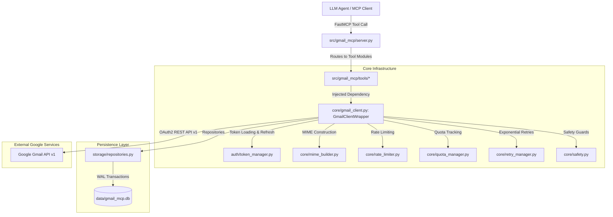

# Gmail MCP — Master Architecture, Directory Map & Tool Reference

> **Workspace Root**: `D:\Projects\gmail_mcp`  
> **Environment & Package Manager**: `uv` with active `.venv`  
> **Python Version**: `>=3.11` (Runtime: CPython 3.13)

---

## 1. Executive Summary & Architecture Overview

`gmail_mcp` is an enterprise-grade Model Context Protocol (MCP) server exposing **57 specialized tools** to LLM agents (Claude Code, Google Antigravity, Cursor, etc.) for autonomous Gmail management.

### Architectural Philosophy
1. **High Safety & Recipient Guardrails**: Rate-limiting token buckets, daily quota accounting, and blocklists prevent runaway loops from spamming or exhausting API limits.
2. **Local Durability & Idempotency**: SQLite database in WAL mode (`data/gmail_mcp.db`) tracks send ledgers, scheduled messages, bulk campaign plans, sync states, and offline email templates.
3. **Thread-Safe REST API Client**: `GmailClientWrapper` manages OAuth credentials, token auto-refresh via PKCE, exponential backoff retries, and thread-local Google API client instances.
4. **FastMCP Integration**: Native `FastMCP` framework exposing typed Pydantic models with complete descriptions and JSON schema exports.



---

## 2. Directory & File Map (What Each File Does & When to Read It)

To prevent LLM context bloat and token waste, **consult this routing guide before opening any file**:

### A. Root Configuration & Entry Points
| File | Responsibility & Purpose | When an Agent Should Read It |
| :--- | :--- | :--- |
| [`main.py`](file:///D:/Projects/gmail_mcp/main.py) | CLI entry point launching server or CLI auth helpers. | When checking or modifying top-level server launch parameters. |
| [`pyproject.toml`](file:///D:/Projects/gmail_mcp/pyproject.toml) | Build system, package metadata, dependencies, and pytest configuration. | When inspecting project dependencies, scripts, or package metadata. |
| [`requirements.txt`](file:///D:/Projects/gmail_mcp/requirements.txt) | Pinned Python dependencies (`google-api-python-client`, `mcp`, `pydantic`, etc.). | When checking installed package versions. |
| [`.env.example`](file:///D:/Projects/gmail_mcp/.env.example) | Example environment variables template. | When reviewing configuration keys (`GMAIL_MCP_CONFIG_DIR`, etc.). |
| `token.json` | Active OAuth access and refresh tokens. | **NEVER READ DIRECTLY** (contains sensitive credentials). |
| `creds_mcp_agy.json` | Google Cloud OAuth2 Client Secret JSON. | **NEVER READ DIRECTLY** (managed by `TokenManager`). |

---

### B. Core Application (`src/gmail_mcp/`)

#### Configuration & Main Server
- [`src/gmail_mcp/config.py`](file:///D:/Projects/gmail_mcp/src/gmail_mcp/config.py):
  - **Purpose**: Defines `GmailConfig` dataclass storing paths (`db_path`, `token_path`, `credentials_path`), quota limits (250/min, 15000/day), safety limits (max attachments: 25MB, max bulk batch: 50), and directory bootstrap.
  - **Read when**: Adjusting runtime directories, timeouts, limits, or default paths.
- [`src/gmail_mcp/server.py`](file:///D:/Projects/gmail_mcp/src/gmail_mcp/server.py):
  - **Purpose**: Instantiates `FastMCP("gmail", ...)`, registers all 57 tools across 14 modules, and implements the `--dump-schemas` CLI export for lazy/eager MCP integration.
  - **Read when**: Adding a new MCP tool, updating top-level tool descriptions, or modifying server startup flags.

#### Authentication (`src/gmail_mcp/auth/`)
- [`src/gmail_mcp/auth/credentials.py`](file:///D:/Projects/gmail_mcp/src/gmail_mcp/auth/credentials.py):
  - **Purpose**: Validates and parses Google Cloud OAuth2 client secrets (`client_id`, `client_secret`, `redirect_uris`).
  - **Read when**: Debugging OAuth client configuration or credential loading errors.
- [`src/gmail_mcp/auth/token_manager.py`](file:///D:/Projects/gmail_mcp/src/gmail_mcp/auth/token_manager.py):
  - **Purpose**: Thread-safe loading, validation, saving, and auto-refresh of Google OAuth `Credentials`.
  - **Read when**: Diagnosing authentication expiration, token refreshes, or scope issues.
- [`src/gmail_mcp/auth/oauth.py`](file:///D:/Projects/gmail_mcp/src/gmail_mcp/auth/oauth.py):
  - **Purpose**: Runs browser-based OAuth 2.0 PKCE authorization flow or out-of-band console flow for initial user login.
  - **Read when**: Modifying login flows, redirect ports (default 8080), or scopes.

#### Core Engine (`src/gmail_mcp/core/`)
- [`src/gmail_mcp/core/gmail_client.py`](file:///D:/Projects/gmail_mcp/src/gmail_mcp/core/gmail_client.py):
  - **Purpose**: Central dependency container (`GmailClientWrapper`). Manages thread-local `googleapiclient.discovery.Resource`, short-lived metadata caching (30s TTL for profile and labels), quota tracking, and rate limiting.
  - **Read when**: Understanding how API requests are dispatched, mocked, or cached.
- [`src/gmail_mcp/core/mime_builder.py`](file:///D:/Projects/gmail_mcp/src/gmail_mcp/core/mime_builder.py):
  - **Purpose**: Creates RFC 2822-compliant MIME messages (`multipart/mixed`, `multipart/alternative`, `multipart/related`), handles UTF-8 subjects, HTML/plain-text bodies, inline images, and file attachments.
  - **Read when**: Modifying email encoding, headers (`Message-ID`, `In-Reply-To`, `References`), or attachment assembly.
- [`src/gmail_mcp/core/pagination.py`](file:///D:/Projects/gmail_mcp/src/gmail_mcp/core/pagination.py):
  - **Purpose**: Clean async pagination generators wrapping Google's `nextPageToken`.
  - **Read when**: Working on batch message/thread retrieval.
- [`src/gmail_mcp/core/quota_manager.py`](file:///D:/Projects/gmail_mcp/src/gmail_mcp/core/quota_manager.py):
  - **Purpose**: Tracks Gmail API unit consumption (e.g., send = 100 units, read = 5 units) using sliding SQLite windows to prevent 429 quota exhaustion.
  - **Read when**: Adjusting quota costs, window durations, or budget thresholds.
- [`src/gmail_mcp/core/rate_limiter.py`](file:///D:/Projects/gmail_mcp/src/gmail_mcp/core/rate_limiter.py):
  - **Purpose**: In-memory token bucket rate limiter per operation class (`READ`, `COMPOSE`, `SEND`).
  - **Read when**: Adjusting burst or sustained rate limiting.
- [`src/gmail_mcp/core/retry_manager.py`](file:///D:/Projects/gmail_mcp/src/gmail_mcp/core/retry_manager.py):
  - **Purpose**: Classified exponential backoff with full jitter for transient HTTP errors (429, 500, 503).
  - **Read when**: Tuning retry attempts, backoff multipliers, or exception classifications.
- [`src/gmail_mcp/core/safety.py`](file:///D:/Projects/gmail_mcp/src/gmail_mcp/core/safety.py):
  - **Purpose**: Validates email recipients against malicious patterns, checks domain blocklists, validates attachment file types/sizes, and resolves safe file paths (allows attachments from any directory via `allow_any_attachment_dir`).
  - **Read when**: Reviewing safety constraints or updating domain restrictions.

#### Local Storage & Repositories (`src/gmail_mcp/storage/`)
- [`src/gmail_mcp/storage/database.py`](file:///D:/Projects/gmail_mcp/src/gmail_mcp/storage/database.py):
  - **Purpose**: Manages SQLite connection pooling, WAL mode, pragmas (`busy_timeout = 5000`), and runs schema migrations.
  - **Read when**: Updating database connections, migrations, or concurrency settings.
- [`src/gmail_mcp/storage/models.py`](file:///D:/Projects/gmail_mcp/src/gmail_mcp/storage/models.py):
  - **Purpose**: Typed dataclasses (`EmailTemplate`, `SendLedgerEntry`, `BulkSendPlan`, `ScheduledJob`, `SyncStateRecord`).
  - **Read when**: Inspecting SQLite table entities and datatypes.
- [`src/gmail_mcp/storage/repositories.py`](file:///D:/Projects/gmail_mcp/src/gmail_mcp/storage/repositories.py):
  - **Purpose**: Specialized CRUD repositories: `TemplateRepository`, `SendLedgerRepository`, `BulkPlanRepository`, `ScheduledJobRepository`, `SyncStateRepository`, `QuotaWindowRepository`.
  - **Read when**: Working on database query logic, idempotency ledger lookups, or local template storage.
- [`src/gmail_mcp/storage/migrations/v001_initial.py`](file:///D:/Projects/gmail_mcp/src/gmail_mcp/storage/migrations/v001_initial.py):
  - **Purpose**: Initial DDL creating tables (`email_templates`, `send_ledger`, `bulk_plans`, `scheduled_jobs`, `sync_state`, `quota_windows`).
  - **Read when**: Inspecting raw SQLite table schemas and indexes.

---

### C. Tool Implementations (`src/gmail_mcp/tools/`)

All 57 tools are categorized across 14 dedicated modules:

| Module File | Exposed Tools | Description |
| :--- | :--- | :--- |
| [`tools/account.py`](file:///D:/Projects/gmail_mcp/src/gmail_mcp/tools/account.py) | `gmail_auth_status`<br>`gmail_get_profile`<br>`gmail_health_check`<br>`gmail_get_runtime_limits`<br>`gmail_get_mailbox_stats` | Inspects account connection, email address, total messages/threads, and active rate limits. |
| [`tools/mailbox.py`](file:///D:/Projects/gmail_mcp/src/gmail_mcp/tools/mailbox.py) | `gmail_get_mailbox_settings`<br>`gmail_update_vacation_settings` | Inspects mailbox configuration, POP/IMAP, and configures Out-of-Office auto-responders. |
| [`tools/messages.py`](file:///D:/Projects/gmail_mcp/src/gmail_mcp/tools/messages.py) | `gmail_get_message`<br>`gmail_list_unread`<br>`gmail_export_messages`<br>`gmail_modify_messages`<br>`gmail_bulk_label_messages` | Reads message contents/headers, retrieves unread emails, exports EML/JSON, and modifies labels. |
| [`tools/threads.py`](file:///D:/Projects/gmail_mcp/src/gmail_mcp/tools/threads.py) | `gmail_get_thread` | Retrieves an entire email conversation thread with chronological message tree. |
| [`tools/search.py`](file:///D:/Projects/gmail_mcp/src/gmail_mcp/tools/search.py) | `gmail_search_messages`<br>`gmail_search_threads` | Executes Gmail search queries (`from:`, `has:attachment`, `after:`, `is:unread`) across messages/threads. |
| [`tools/drafts.py`](file:///D:/Projects/gmail_mcp/src/gmail_mcp/tools/drafts.py) | `gmail_create_draft`<br>`gmail_get_draft`<br>`gmail_list_drafts`<br>`gmail_update_draft`<br>`gmail_delete_draft`<br>`gmail_duplicate_draft` | Full lifecycle management of Gmail drafts (create, view, edit, duplicate, remove). |
| [`tools/sending.py`](file:///D:/Projects/gmail_mcp/src/gmail_mcp/tools/sending.py) | `gmail_send_email`<br>`gmail_send_reply`<br>`gmail_send_reply_all`<br>`gmail_forward_message` | Primary outbound sending tools with idempotency tokens and thread continuation. |
| [`tools/bulk_operations.py`](file:///D:/Projects/gmail_mcp/src/gmail_mcp/tools/bulk_operations.py) | `gmail_bulk_create_drafts`<br>`gmail_bulk_attach_to_drafts`<br>`gmail_prepare_bulk_send`<br>`gmail_execute_bulk_send`<br>`gmail_prepare_bulk_reply`<br>`gmail_execute_bulk_reply` | Safe two-phase bulk operations (prepare plan -> human/agent verification -> execute send). |
| [`tools/attachments.py`](file:///D:/Projects/gmail_mcp/src/gmail_mcp/tools/attachments.py) | `gmail_get_attachment`<br>`gmail_list_attachments`<br>`gmail_attach_files_to_message` | Downloads attachments to disk, lists parts of an email, and attaches local files to existing drafts. |
| [`tools/labels.py`](file:///D:/Projects/gmail_mcp/src/gmail_mcp/tools/labels.py) | `gmail_list_labels`<br>`gmail_create_label`<br>`gmail_update_label`<br>`gmail_delete_label`<br>`gmail_apply_label`<br>`gmail_remove_label` | Full management of user labels (create, rename, delete, apply, remove from messages). |
| [`tools/filters.py`](file:///D:/Projects/gmail_mcp/src/gmail_mcp/tools/filters.py) | `gmail_list_filters`<br>`gmail_get_filter`<br>`gmail_create_filter`<br>`gmail_delete_filter` | Manages automated inbox filters (criteria: from, subject; actions: archive, label, star). |
| [`tools/templates.py`](file:///D:/Projects/gmail_mcp/src/gmail_mcp/tools/templates.py) | `gmail_create_template`<br>`gmail_get_template`<br>`gmail_list_templates`<br>`gmail_update_template`<br>`gmail_delete_template`<br>`gmail_preview_template` | Offline SQLite template manager supporting variable substitution (e.g. `{{company}}`). |
| [`tools/scheduling.py`](file:///D:/Projects/gmail_mcp/src/gmail_mcp/tools/scheduling.py) | `gmail_schedule_send`<br>`gmail_list_scheduled_sends`<br>`gmail_cancel_scheduled_send`<br>`gmail_process_due_scheduled_sends` | Schedules emails for future delivery with status tracking and runner triggers. |
| [`tools/synchronization.py`](file:///D:/Projects/gmail_mcp/src/gmail_mcp/tools/synchronization.py) | `gmail_start_watch`<br>`gmail_stop_watch`<br>`gmail_sync_history` | Sets up Google Cloud Pub/Sub push notifications (`watch`) and incremental sync via `historyId`. |

---

## 3. Crucial Distinction: SQLite Templates vs. Gmail Web UI Templates

When working with "templates", there are **two distinct systems**:
1. **Gmail Web UI Templates (Canned Responses)**:
   - Stored directly in the user's Gmail mailbox as **Drafts** (`Labels: ['DRAFT']`) with:
     - An **empty `To` recipient**.
     - The **Subject** representing the template title (e.g. `Application for Data Science ...`, `Follow Up Corp`).
   - Accessible via standard Gmail draft tools (`gmail_list_drafts`, `gmail_get_draft`, `gmail_create_draft`) by querying drafts with empty recipients or searching subjects.
2. **Local SQLite Templates (`gmail_*_template`)**:
   - Stored offline in `data/gmail_mcp.db` in table `email_templates`.
   - Managed via the 6 dedicated template tools (`gmail_create_template`, `gmail_list_templates`, etc.).
   - Supports variable placeholders like `{{company}}`, `{{name}}` with `gmail_preview_template`.

---

## 4. Agent Navigation Rules: Avoid Token Bloat

> [!IMPORTANT]
> **DO NOT read unnecessary files.** Always follow this lookup matrix:

| Task at Hand | Files to Read | Files to NEVER Read |
| :--- | :--- | :--- |
| **Inspect tool parameters or schemas** | `src/gmail_mcp/server.py` or `C:\Users\binit\.gemini\antigravity-cli\mcp\gmail\<tool>.json` | `tests/*`, `core/*`, `storage/*` |
| **Modify or debug an MCP tool** | The specific tool file in `src/gmail_mcp/tools/<domain>.py` | Other tool files, `migrations/*` |
| **Debug MIME / attachment assembly** | `src/gmail_mcp/core/mime_builder.py` | `server.py`, `tools/*` |
| **Debug rate limiting or 429 errors** | `src/gmail_mcp/core/rate_limiter.py`, `quota_manager.py` | `auth/*`, `tools/*` |
| **Debug database or migrations** | `src/gmail_mcp/storage/repositories.py`, `database.py` | `core/*`, `auth/*` |
| **Debug OAuth / authentication** | `src/gmail_mcp/auth/token_manager.py`, `oauth.py` | `tools/*`, `data/*` |

---

## 5. Execution Commands & Guidelines

All commands must be executed using `uv` with `--directory "D:\Projects\gmail_mcp"`:

### 1. Running Server & Dumping Schemas
```bash
# Start MCP server over stdio
uv --directory "D:\Projects\gmail_mcp" run python -m gmail_mcp.server

# Dump refreshed JSON schemas for MCP client
uv --directory "D:\Projects\gmail_mcp" run python -m gmail_mcp.server --dump-schemas "C:\Users\binit\.gemini\antigravity-cli\mcp\gmail"
```

### 2. Running Test Suite
```bash
# Run entire test suite
uv --directory "D:\Projects\gmail_mcp" run pytest

# Run unit tests only
uv --directory "D:\Projects\gmail_mcp" run pytest tests/unit/

# Run protocol compliance tests
uv --directory "D:\Projects\gmail_mcp" run pytest tests/integration/test_mcp_protocol.py
```

### 3. Interactive OAuth Login
```bash
# Re-authenticate if token expires or scopes change
uv --directory "D:\Projects\gmail_mcp" run python -m gmail_mcp.auth.oauth --login
```
